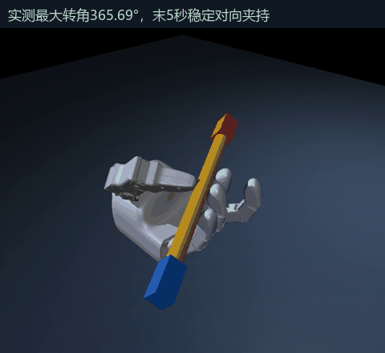
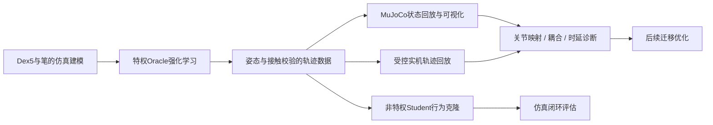

<div align="center">

# Dex5 PenSpin｜灵巧操作与Sim-to-Real

**面向耦合关节灵巧手的强化学习训练、策略蒸馏与真机迁移**

Isaac Lab训练 · Oracle PPO → Student BC · MuJoCo回放可视化 · Sim-to-Real

[项目展示](docs/showcase/index.html) · [迁移分析](docs/sim2real_case_study.md) · [统一项目说明](docs/project_overview.md) · [数据统计](docs/data_statistics.md)



*项目动作诊断与可视化模块的真实物理回放；采用规划辅助和PPO收尾。具体运行引擎及结果来源见[项目说明](docs/project_overview.md)。*

</div>

## 一个项目，四个工程模块

将笔状物体的灵巧操作从仿真训练推进到Dex5实机。核心路线是：**Isaac Lab特权Oracle强化学习 → 验证轨迹与Student蒸馏 → MuJoCo轨迹回放可视化 → Dex5受控真机迁移与诊断**。

项目统一以Isaac Lab作为训练主平台，动作可视化与接触诊断作为配套工具模块。项目重点包括关节耦合建模、接触与奖励设计、数据来源隔离、20维SDK目标到16独立控制通道的适配，以及仿真与实机控制时序对齐。目前已完成短角度仿真学习与学生策略验证，并进行了真机受控回放和局部动作验证；实机连续转笔仍未稳定实现。

## 结果概览

|模块|结果|适用范围|
|---|---|---|
|Student仿真闭环|152/197次严格短角度成功，约77.2%|Isaac历史评估，197个episode来自20个测试来源|
|旋转能力|184/197次达到至少30°实际姿态转动|不是整圈或实机成功率|
|Student数据集|1,200条验证轨迹，69,600个状态转移样本|训练51,621 / 验证6,519 / 测试11,460；按source分组|
|残差PPO控制实验|两次独立运行，共65,536个训练交互步|各32,768步；未超过参考基准，与Student数据分别统计|
|硬件适配|20维绝对URDF关节目标，16独立控制通道|保留厂商SDK的URDF到电机转换|
|实机迁移|完成标定、受控回放及局部转动验证|依据原阶段记录；连续转笔稳定性仍不足|

数据来源：[学生闭环评估](Dex5_Sim2Real_S0/student_s0_11/student_closed_loop_eval.json)、[训练报告](Dex5_Sim2Real_S0/student_s0_11/student_training_report.json)、[阶段合同与记录](AGENTS.md)。这些是项目已有实验记录，本轮文档整理未重跑Isaac或真机。

## 方法与工程实现



- **学习与数据**：Oracle利用仿真状态学习；Student读取340维可部署观测历史，预测有界20维虚拟动作。按轨迹来源划分数据，避免相邻状态泄漏。
- **评估可信度**：依据相邻四元数的实际姿态变化验证转动；结合目标轴、接触、穿透和150ms稳定保持，避免只积分角速度造成“假转动”。
- **硬件接口**：处理耦合关节、方向与偏置、迟滞、动作插值及反馈监控；逻辑控制量不是电机轴角度，继续通过厂商SDK执行。
- **迁移策略**：先做静态保持和受控回放，再讨论自主闭环与真实数据适配。当前未完成Student实机自主闭环验证。

## 实机迁移与工程优化

实际迁移中存在关节耦合、控制映射、负载下反馈瞬态以及策略频率与SDK指令频率不一致等工程问题。这些现象支持耦合建模、增益及执行时序的联合排查，具体因果贡献仍需受控实验验证。

已有记录包含局部PIP/DIP响应比约0.29、14–31ms可检测起动延迟、60Hz策略到100Hz指令链，以及负载回放中的独立关节反馈瞬态。这些结果对应特定标定条件，不是硬件的通用极限。详见[实机迁移案例分析](docs/sim2real_case_study.md)。

## 动作诊断与可视化模块

[完整仿真视频](docs/showcase/media/baseline-v12.mp4)用于解释转动、拇指换位、接回和稳定夹持，是同一项目的动作诊断素材。该模块使用MuJoCo执行规划参考与PPO收尾，训练主线使用Isaac Lab；保留引擎来源与模型假设，避免混合不同任务的成功率。质量审计见[实验边界](docs/results_and_limits.md)。

[残差PPO控制探索](experiments/rl13/README.md)归入控制优化模块，保留完整日志。它是本项目中的探索实验，当前尚未超过基准。

## 展示与复现

```bash
python scripts/project.py showcase
```

打开 `http://127.0.0.1:8831/docs/showcase/`，可查看同一项目的仿真学习、策略蒸馏、真机迁移和动作诊断四个模块。

- 训练模块（Isaac Lab）：[跨机器复现](docs/reproducibility.md)、[任务设计](docs/dex5_penspin_reproduction_plan.md)。
- 动作诊断模块：[实验说明](experiments/rl13/README.md)。完整参考回放目前仅Windows认证。
- 数据统计：[样本划分、训练步数与统计口径](docs/data_statistics.md)。
- 数据扩展：[200个候选增量起步、逐步扩展覆盖的计划](docs/data_scaling_plan.md)，尚未执行，现有结果不变。

历史训练、标定和实机数据独立保留。当前下载副本中部分历史大文件是Git LFS指针，复现原Isaac实验需按原文档获取资产。

## 参考

[Lessons from Learning to Spin “Pens”](https://arxiv.org/abs/2407.18902)及[原代码](https://github.com/HaozhiQi/penspin)提供Oracle→Student与仿真到实机的研究背景。本项目展示Dex5适配和工程验证，不宣称算法首创或已实现论文中的实机多物体多圈效果。

统一命令入口：`python scripts/project.py evidence`查看成果来源，`python scripts/project.py audit`检查展示链接。模块职责与数据合同见[统一项目说明](docs/project_overview.md)。
