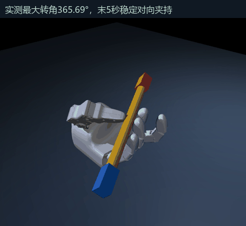
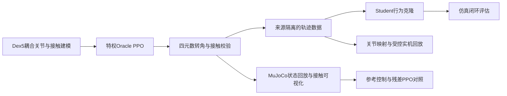
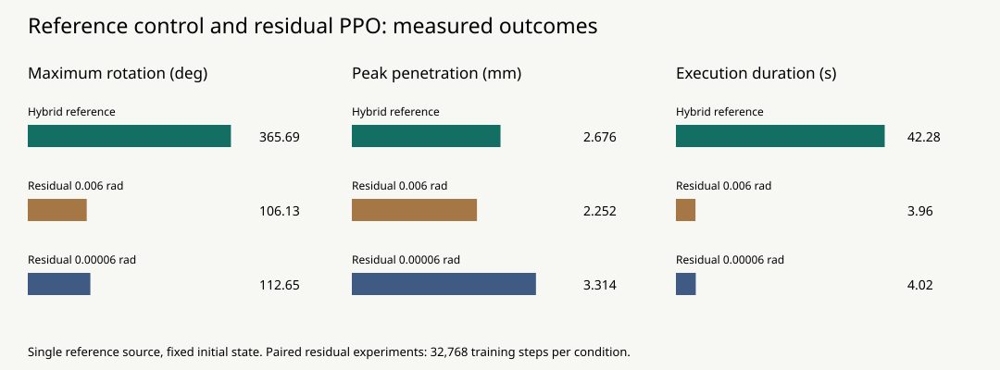

<div align="center">

# Dex5 PenSpin｜灵巧操作与 Sim-to-Real

**面向耦合关节灵巧手的强化学习、策略蒸馏与硬件适配**

Isaac Lab Oracle PPO · Student BC · Residual PPO · MuJoCo · Sim-to-Real

[项目展示](docs/showcase/index.html) · [方法与工程实现](docs/project_overview.md) · [实机迁移](docs/sim2real_case_study.md) · [实验结果](docs/results_and_limits.md)



*MuJoCo动作诊断：物理规划与PPO收尾串联，展示转动、拇指换位、接回与稳定夹持。*

</div>

## 项目工作

围绕笔状物体的多指操作，搭建 **Oracle强化学习 → 四元数轨迹校验 → Student行为克隆 → 仿真闭环评估 → 硬件映射与受控回放** 的实验流程，并实现MuJoCo物理回放与残差PPO控制实验。

- **仿真任务与Oracle：** 在Isaac Lab中建模Dex5耦合关节与笔接触，设计目标轴转动、姿态对齐和稳定保持联合评估。
- **数据与策略蒸馏：** 整理1,200条四元数验证轨迹、69,600个状态转移；Student以340维观测历史预测20维有界虚拟动作，按轨迹来源划分训练、验证和测试集。
- **旋转与接触评估：** 使用相邻四元数推导实际转角及有限步角速度，同步记录接触、穿透、终态预重置快照与150ms保持状态。
- **硬件适配：** 对接20维绝对URDF关节目标与16个独立控制通道，完成方向、偏置、迟滞辨识及60Hz策略到100Hz指令链的时序适配。
- **控制与可视化：** 实现MuJoCo参考回放、有界残差PPO、幅度消融、接触状态图和训练检查点曲线，形成可追溯的实验档案。

## 实验结果

| 模块 | 记录结果 | 实验设置 |
| --- | --- | --- |
| Student仿真闭环 | **152/197次严格短角度成功，77.2%** | Isaac Lab；197个测试episode来自20个来源；150ms保持 |
| Student转角 | 184/197次达到30°四元数转角 | 硬件兼容Medium DR控制接口 |
| Student训练 | 验证MSE 0.000780，测试MSE 0.000654 | 891/112/197个训练、验证、测试episode |
| 参考辅助仿真回放 | **最大实际转角365.69°，末5秒对向夹持100%** | MuJoCo；单参考轨迹；规划辅助与PPO收尾 |
| 残差PPO消融 | 两次各32,768步，共65,536个交互步 | 对比0.006与0.00006 rad残差上限 |
| 硬件标定与回放 | 16/16控制通道映射验证；静态持笔与受控局部转动 | 分方向分段逆映射、负载反馈与启动流程诊断 |

来源：[Student评估](Dex5_Sim2Real_S0/student_s0_11/student_closed_loop_eval.json)、[训练报告](Dex5_Sim2Real_S0/student_s0_11/student_training_report.json)、[数据统计](docs/data_statistics.md)、[实验记录](docs/results_and_limits.md)。

## 方法与工程实现



**策略与数据。** Oracle读取仿真笔状态和接触信息，Student读取观测历史。通过 `source_trajectory_id` 隔离数据来源，保存动作历史、归一化参数和终态快照，形成可复核的数据与模型接口。

**姿态评估。** 用相对四元数衡量目标轴实际转动，结合轴对齐、接触、穿透和保持时长评估动作。有限步角速度由相邻姿态计算，瞬时物理引擎速度用于接触冲击诊断。

**硬件接口。** 保留厂商SDK的URDF到电机转换，适配关节方向、偏置、耦合、迟滞与时序。实机记录包含约0.29的局部PIP/DIP响应比、14–31ms可检测起动延迟，以及9.8mm笔条件下的静态保持与局部转动回放。详见[Sim-to-Real工程分析](docs/sim2real_case_study.md)。

## 参考控制与残差PPO

在MuJoCo中组合物理规划前缀与PPO收尾，形成42.28秒连续参考回放；在参考关节目标上叠加有界、低通滤波的16维策略残差。采用同参考、同起点、同种子和同预算对比两种残差幅度，并记录检查点回报、转角、执行时长、接触与穿透。

[仿真视频](docs/showcase/media/full-turn-demo.mp4) · [残差PPO方法](docs/residual_ppo_method.md) · [实验报告](docs/residual_ppo_experiment.md) · [幅度消融](docs/residual_ppo_ablation.md) · [实验档案](experiments/rl13/runs/README.md)



## 展示与复现

```bash
python scripts/project.py showcase
```

打开 `http://127.0.0.1:8831/docs/showcase/`，查看策略蒸馏、实机适配、仿真回放与训练曲线。

- [项目结构与模块入口](docs/project_overview.md)
- [Isaac Lab训练复现](docs/reproducibility.md) · [任务设计](docs/dex5_penspin_reproduction_plan.md)
- [MuJoCo残差实验](experiments/rl13/README.md) · [方法说明](docs/rl13_method.md)
- [数据规模与划分](docs/data_statistics.md) · [数据扩展方案](docs/data_scaling_plan.md)

`python scripts/project.py evidence` 输出实验来源，`python scripts/project.py audit` 检查展示链接。数据与模型通过Git LFS及对应实验目录管理，运行环境按各模块复现文档配置。

## 参考

[Lessons from Learning to Spin “Pens”](https://arxiv.org/abs/2407.18902)及[原代码](https://github.com/HaozhiQi/penspin)提供Oracle→Student与仿真到实机的研究背景。本项目围绕Dex5完成任务适配、数据校验、控制接口、策略蒸馏与工程实验。
