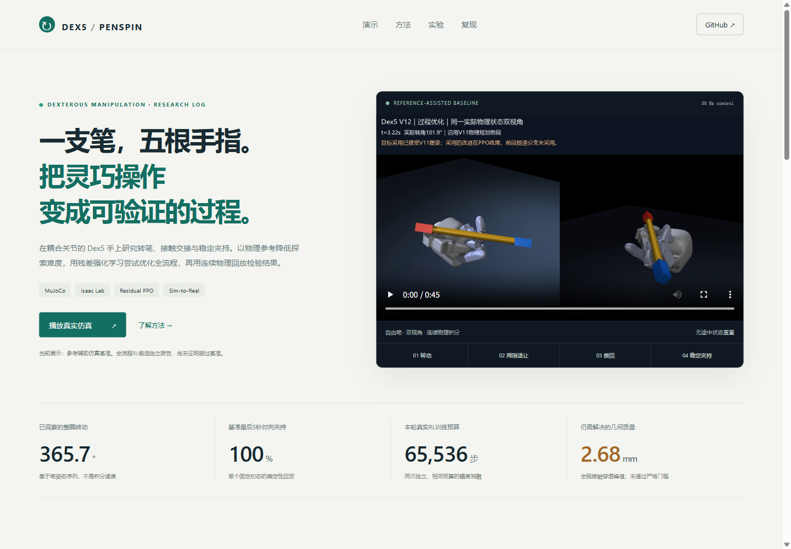
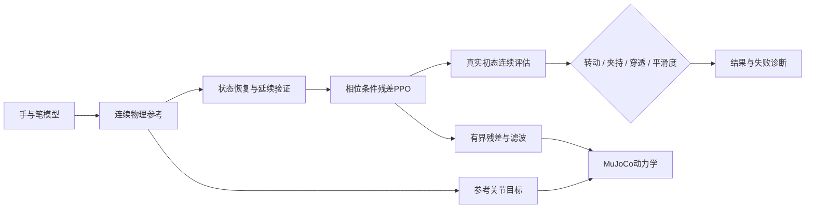

<div align="center">

# Dex5 · PenSpin

**耦合关节灵巧手上的转笔、接触交接与强化学习研究**

MuJoCo · Isaac Lab · Residual PPO · Oracle → Student

[交互展示](docs/showcase/index.html) · [方法](docs/rl13_method.md) · [实验结果](docs/results_and_limits.md) · [面试讲解](docs/interview_guide.md)


*参考辅助基准的0–8秒片段；不是从零训练的端到端RL策略。*

</div>

## 项目概览

研究16个主动控制通道、4个耦合远端关节的Dex5手如何操纵笔状物体。包括手与笔建模、参考辅助控制、全流程残差PPO、接触/姿态评估、可追溯数据，以及独立的历史Isaac Lab学生策略与真机标定流程。

**当前：整圈基准已观察到转动与夹持；新全流程RL尚未超过基准；严格几何质量仍待优化。**

|证据层|实测结果|范围|
|---|---|---|
|整圈MuJoCo基准|最大365.69°；末5秒对向夹持100%|参考辅助、固定初态、1个来源，不是泛化成功率|
|全程几何审计|最大接触穿透2.676mm|不满足≤0.5mm严格门槛|
|本轮全流程残差PPO|两次独立32,768步，共65,536步|101维观测/16维动作；两个幅度候选均未晋级|
|历史Isaac学生策略|152/197次短角度严格成功|历史报告，本轮未重新运行，不是整圈成功率|

[完整视频](docs/showcase/media/baseline-v12.mp4) · [原始评估](experiments/rl13/results/baseline.json) · [训练日志](experiments/rl13/results/) · [质量审计](experiments/rl13/results/quality_audit.json)

## 离线交互展示

```bash
python scripts/serve_showcase.py
```

打开 `http://127.0.0.1:8831/docs/showcase/`：视频阶段跳转、成果切换、真实姿态/夹持曲线、训练回报、证据链接与命令复制。无需前端构建或API，也可直接打开HTML。



## 方法



`u = u_ref + residual`：策略全程读取相位、关节、模拟笔状态及接触信息，输出小幅关节修正。训练窗口覆盖整条参考，正式评估从原始初态开始，不通过中途重置拼接成功。

这是参考辅助的特权仿真策略，未新增实机部署或学生蒸馏；只有一个参考来源，无法证明跨来源泛化。MDP、奖励和假设见[方法文档](docs/rl13_method.md)。

## 复现新增MuJoCo支线

在独立Python环境中运行，已验证Windows / Python3.14 / CPU：

完整参考回放当前仅在Windows认证。Linux CI已发现接触延续差异，不能把同平台接口测试通过当作跨OS复现成功，详见[平台审计](experiments/rl13/results/platform_portability.json)。

```bash
pip install -r experiments/rl13/requirements.txt
python -m experiments.rl13.validate_reference
python -m experiments.rl13.evaluate --tag baseline
python -m experiments.rl13.export_showcase
python scripts/serve_showcase.py
```

训练入口为 `python -m experiments.rl13.train` 与 `python -m experiments.rl13.train_micro`。脚本拒绝覆盖已有同名训练日志，重训应在独立工作副本记录新版本。所选权重、完整参考和真实日志随新增模块提供。

```bash
python -m pytest experiments/rl13/tests tests/test_dex5_hardware_adapter.py tests/test_canonical_reset_schema.py
python scripts/audit_showcase.py
```

## 导航

```text
experiments/rl13/           新增：残差PPO、模型、参考、训练与评估
docs/showcase/             新增：离线交互研究展示
docs/interview_guide.md     面试讲解与常见追问
docs/results_and_limits.md  实验结果与限制
scripts/serve_showcase.py   本地展示启动入口
isaac/                     历史Isaac Lab任务与Oracle训练
sim2real/                  历史学生训练与硬件兼容适配
Dex5_Sim2Real_S0/           历史校验报告与数据合同
sim/                       历史MuJoCo与接触诊断
docs/archive/              整理前的README
```

历史Isaac路径与冻结数据独立保留，环境和LFS步骤见[原复现说明](docs/reproducibility.md)。新增仿真假设约0.829耦合比与历史实机局部约0.29辨识值不能互换。

## 参考与归属

- [Lessons from Learning to Spin “Pens”](https://arxiv.org/abs/2407.18902) / [原始代码](https://github.com/HaozhiQi/penspin)：Oracle→Student及仿真到实机研究背景。
- [Residual Reinforcement Learning for Robot Control](https://arxiv.org/abs/1812.03201)：参考控制与学习修正的组合思路。
- [SB3 PPO](https://stable-baselines3.readthedocs.io/en/master/modules/ppo.html)：本轮优化器实现。
- Unitree Dex5模型来源和许可证见 `experiments/rl13/runtime/assets/hand/`；笔网格由本项目程序创建。未给授权不明确的历史资产擅自添加统一开源许可。
