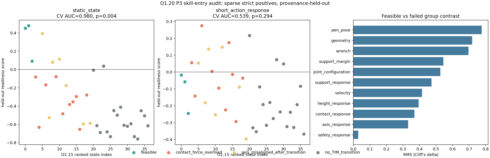

# O1.20 Canonical Entry Audit 验收报告

## 结论

`PASS_DIAGNOSTIC_P3H_CANDIDATE_SUPPORTED`

O0 的 P3 状态仍然是合法、可重建的 canonical reset；但当前证据不足以把其改成 P3-H skill-entry distribution。O1.15 的 37 个条件候选中只有 3 个独立严格正样本，且均不是鲁棒 basin。

## 证据口径

- O1.8 本地修正记录：`0/12` strict feasible。
- O1.15 后续严格存在性：`3/37`，bank `831, 894, 1155`。
- 正样本来自 3 个独立 parent 和 3 个独立 source trajectory。
- 全部结论只适用于 O1.14 筛出的 37 个短时响应候选，不代表完整 P3 分布。

## 区分能力

| 特征族 | provenance holdout AUC | permutation p | 三个正样本均高于失败中位数 |
|---|---:|---:|---:|
| 静态状态 | 0.980 | 0.004 | True |
| 短动作响应 | 0.539 | 0.294 | False |
| 合并 | 0.892 | 0.021 | True |

分类器门槛：`SUPPORTED_FOR_FUTURE_CONFIRMATION`。候选排名仅用于下一次独立确证审计，不能用作 reset filter、teacher 或 PPO curriculum。

## Canonical 决策

`RUN_INDEPENDENT_CONFIRMATORY_AUDIT_BEFORE_P3H`

当前可支持的结论是：稳定 P3 不等于 handoff-ready P3，但尚未找到能在独立来源上泛化的 skill-entry 边界。下一步应使用冻结的 O1.15 搜索口径审计 quarantine ranking，而不是现在修改 O0/P3。

