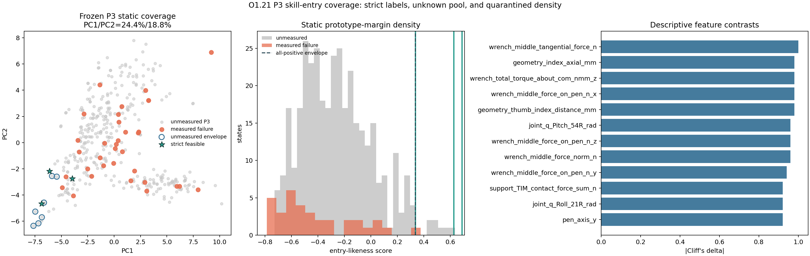

# O1.21 Skill Entry Coverage Audit 验收报告

## 结论

`PASS_DIAGNOSTIC_SPARSE_NONZERO_ENTRY_COVERAGE`

P3 canonical bank 中已经包含 handoff-entry，但高置信区域稀疏。当前支持 **A + C**：现有 P3 覆盖不足，同时 policy exploration 仍是主要瓶颈；**B 暂不支持**，因为冻结 bank 中仍有来源独立、未做长时域验证的高分候选。

## 总体口径

- P3 状态：`396`
- 长时域已测：`37`
- 未测：`359`，它们是 unknown，不是 non-feasible
- 已知严格可行：`3`，占全 P3 `0.76%`

## Candidate Density

| 层级 | 状态 | P3 密度 | 正样本召回 | 已知失败选中率 | 未测候选 |
|---|---:|---:|---:|---:|---:|
| 零已知失败核心 | 9 | 2.27% | 66.7% | 0.0% | 7 |
| 全正样本包络 | 11 | 2.78% | 100.0% | 2.9% | 7 |
| 5% 失败容忍带 | 46 | 11.62% | 100.0% | 5.9% | 41 |

这些数字是静态特征候选密度，不是物理 feasible rate。

## A/B/C 判断

- **A：支持。** 覆盖全部三个正样本的高置信包络仅占 P3 `2.78%`。
- **B：暂不支持。** 先验证现有 bank 内的独立候选，再决定是否需要重新采样 canonical。
- **C：支持。** P3 内已存在严格 handoff 入口，但既有 PPO 未发现 qualified handoff；稀疏 reset 概率会放大这个 exploration 问题。

## 边界

不修改 O0，不创建 P3-H，不把候选当作 reset filter。下一道门是对隔离候选执行独立长时域确证。

