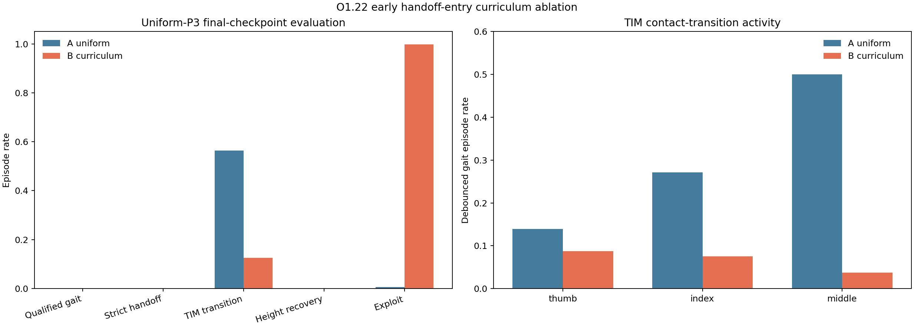

# O1.22 Handoff Basin Curriculum Audit 验收报告

## 结论

`ENTRY_OVERSAMPLING_HURTS_DISCOVERY_AND_INCREASES_EXPLOIT`

本轮早期 handoff-entry 过采样**没有提高 skill discovery**，并且产生了明显的接触丢失投机。

| 指标 | A uniform | B curriculum | B-A |
|---|---:|---:|---:|
| Qualified gait | 0.00% | 0.00% | +0.00% |
| Strict support handoff | 0.00% | 0.00% | +0.00% |
| TIM transition | 56.47% | 12.55% | -43.92% |
| Height recovery | 0.00% | 0.00% | +0.00% |
| Exploit | 0.63% | 99.70% | +99.07% |

## 解读

- A/B 的 qualified gait 和 strict handoff 都是 `0`。
- B 的 TIM transition 从 `56.47%` 降到 `12.55%`。
- B 的 exploit 从 `0.63%` 上升到 `99.70%`，主要是 contact loss。
- A 也不是成功 policy：它的 height recovery 仍为 `0`，且几乎所有 episode 都丢失高度。

因此，O1.21 的静态 entry-likeness 不能直接当作 PPO curriculum 难度指标。这个结果否定当前 75% 早期过采样方案，不否定所有 reset curriculum。

