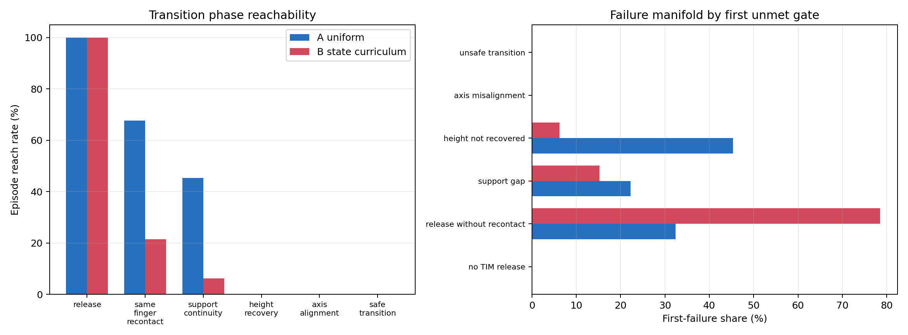

# O1.23 Failure Manifold / Transition Phase Analysis 验收报告

## 结论

`STATE_CURRICULUM_REJECTED__P4_TO_P5_CAPTURE_AUDIT_REQUIRED`

O1.22 的静态 P3 state curriculum 不是答案。当前 uniform policy 已经能够频繁产生
TIM 释放和同指重接触，但无法把接触事件转化为持续承力与高度恢复。问题已经进入
transition learning，而不是继续寻找更好的 P3。

## V9 语义修正

经用户对真实动作复核，当前可视化并不是“P3→P4 尚未成立”，而是已经进入预期的
**P4 动态绕行**：食指和中指控制笔绕过拇指。当笔的一端从拇指内侧到达拇指与食指
之间时，应结束 P4 并切换到 P5，由拇指和食指捏持。

当前策略在该捕获窗口没有建立拇食指捏持，仍继续执行食指/中指推进，并出现疑似借助
穿透强行绕过拇指的行为。因此，原先的通用 TIM handoff 指标不能直接解释为 P5 成功，
此前“可以开始 transition-phase curriculum”的决定已撤销。

## 匹配实验

- A：O1.22 uniform P3 checkpoint。
- B：O1.22 static-entry curriculum checkpoint。
- 两者使用相同的 256 个有序 P3 bank row、相同 O0 hash、相同 seed。
- 每条轨迹固定运行 120 个控制步，并禁用正常早停，避免 termination 改变比较口径。
- 轨迹只用于诊断，不是 teacher、reset bank 或训练数据。

## 累计 Transition 漏斗

| 累计阶段 | A uniform | B state curriculum |
|---|---:|---:|
| TIM release | 256 / 256 = **100.00%** | 256 / 256 = **100.00%** |
| Same-finger recontact | 173 / 256 = **67.58%** | 55 / 256 = **21.48%** |
| Support continuity | 116 / 256 = **45.31%** | 16 / 256 = **6.25%** |
| Height recovery | 0 / 256 = **0.00%** | 0 / 256 = **0.00%** |
| Axis gate after recovery | 0 | 0 |
| Strict safe transition | 0 | 0 |

## Failure Manifold

A uniform 的首个失败门：

| 失败相位 | 数量 |
|---|---:|
| release 后无同指重接触 | 83 |
| 重接触后 support gap | 57 |
| 接触连续但高度不恢复 | **116** |

B static curriculum 的首个失败门：

| 失败相位 | 数量 |
|---|---:|
| release 后无同指重接触 | **201** |
| 重接触后 support gap | 39 |
| 接触连续但高度不恢复 | 16 |

静态 curriculum 将失败从“重接触后的恢复失败”提前成“无法完成重接触”，并未扩大
transition skill。A 的 173 条 transition episode 中，TIM overlap 中位数为 85.71%，
但最小法向承力保留比中位数仅约 0.047%，说明接触标签连续并不等于有效承力连续。

## 决策门

下一步先执行只读的 **P4→P5 capture-window / penetration audit**：

```text
P4 index-middle drive
  -> pen end enters thumb-index corridor
  -> check mesh penetration
  -> check thumb-index pinch onset
  -> determine whether drive continues after missed capture
```

不允许继续按 P3 bank id 加权，也暂不允许修改 reward、PPO 训练、teacher、skill
pretraining 或 hierarchical policy。只有确认捕获窗口、穿透机制及拇食指捏持缺失的先后
关系后，才能决定是否建立 P4→P5 transition curriculum。


